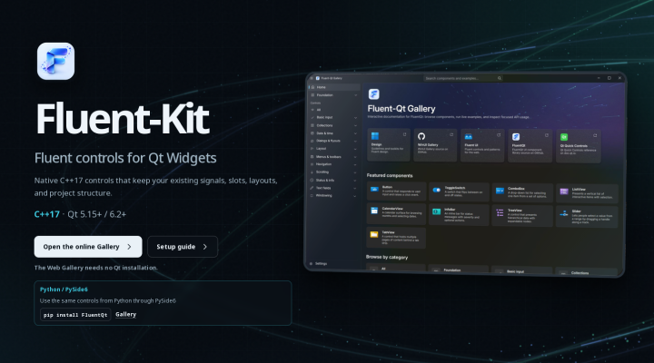
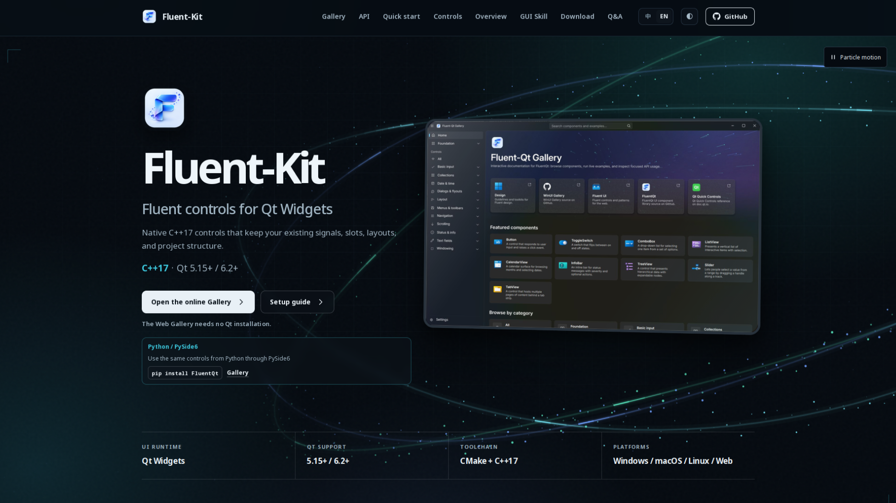
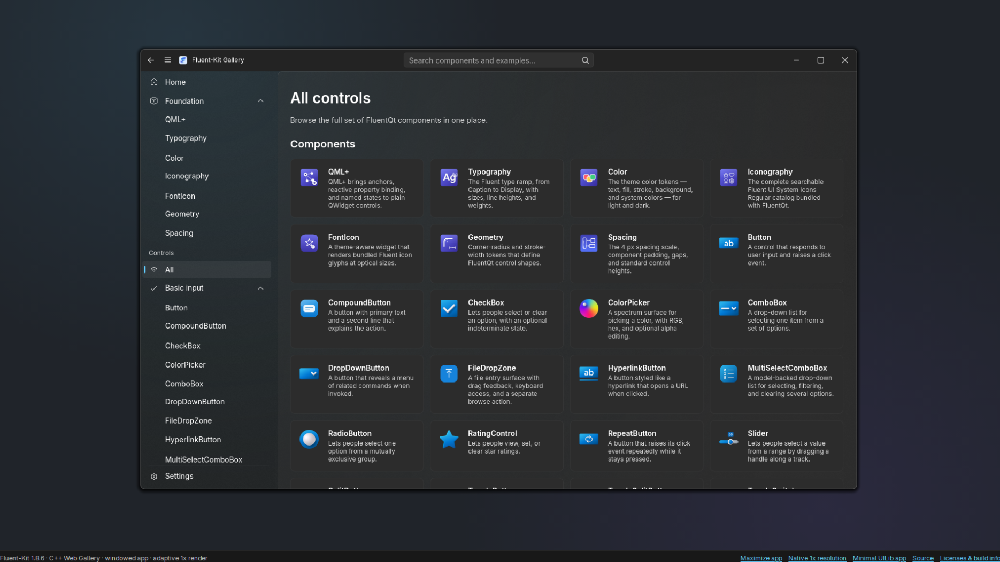
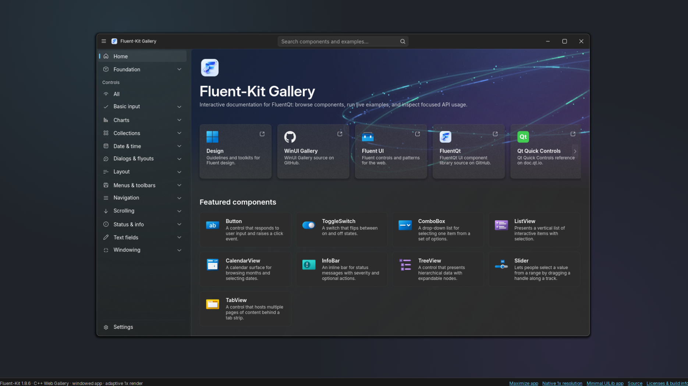
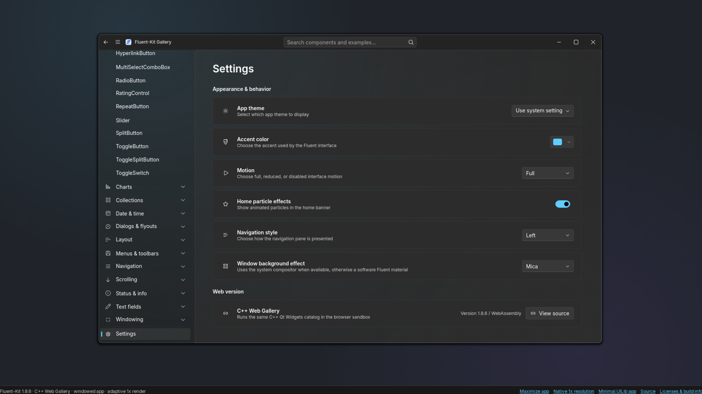
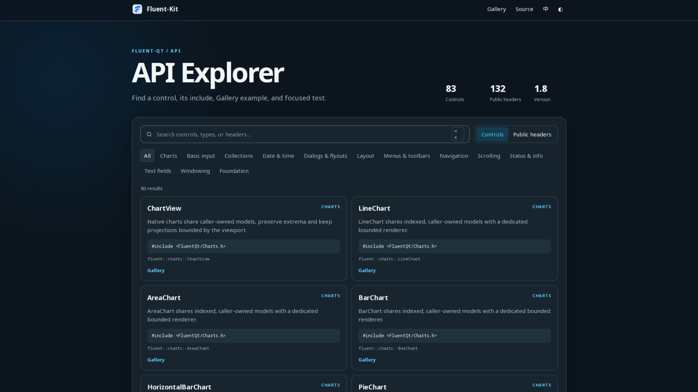
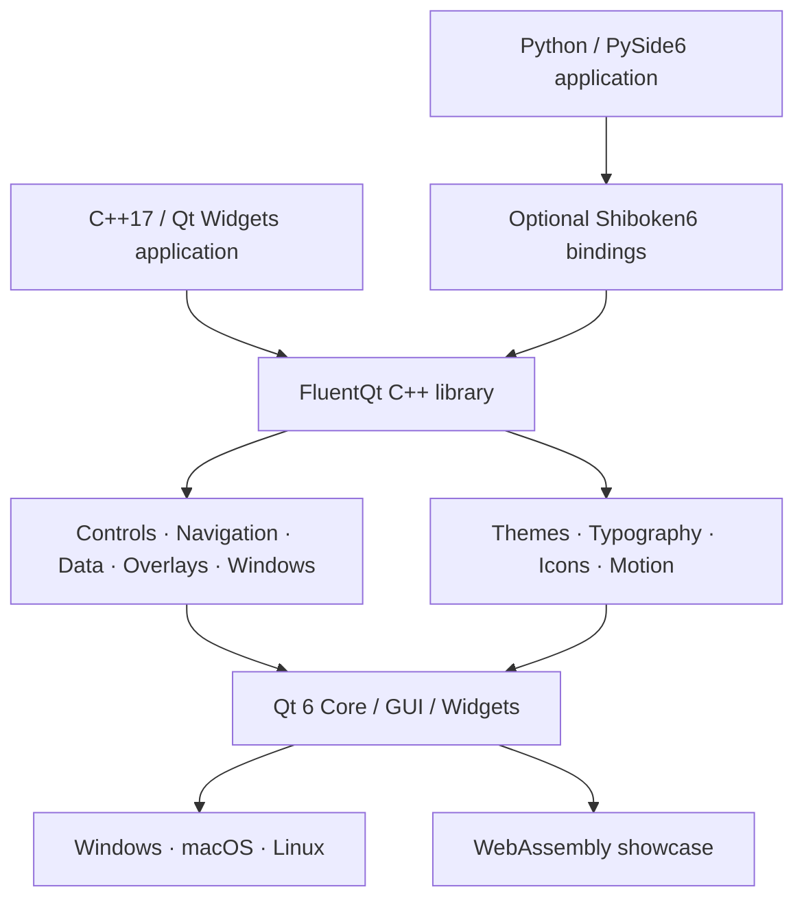

<p align="center">
  
</p>

<h1 align="center">Fluent-Kit</h1>

<p align="center">
  <strong>Thoughtful interfaces. Native Qt foundations.</strong><br />
  A cross-platform, Fluent-inspired UI component library for Qt 6 Widgets.
</p>

<p align="center">
  <a href="https://fluentkit.aberu.site/"><strong>Documentation</strong></a>
  · <a href="https://fluentkit.aberu.site/gallery/">Live Gallery</a>
  · <a href="https://fluentkit.aberu.site/api/">API Explorer</a>
  · <a href="https://github.com/4beru/qt6-fluent-kit/tree/main/examples/hello_world">Hello World</a>
  · <a href="https://github.com/4beru/qt6-fluent-kit/discussions">Discussions</a>
</p>

<p align="center">
  <br />
  <sub>Created by <strong>Abel Ortega</strong> · C++17 · Qt 6 · CMake · Optional PySide6 integration</sub>
</p>

---

## Overview

**Fluent-Kit** (also referred to as **FluentQt** in its packages and APIs) brings a cohesive, Fluent-inspired design language to applications built with **Qt Widgets**. Its purpose is to make polished desktop interfaces practical without abandoning the Qt patterns developers already rely on: widgets, layouts, signals and slots, object ownership, and CMake.

Rather than being a standalone application framework, Fluent-Kit provides reusable UI building blocks that can be composed into real applications. The library focuses on consistent interaction, legible typography, adaptable appearance, and familiar native application workflows.

<p align="center">
  <a href="assets/fluentkit.png">
    
  </a>
</p>

### What you can build

- **Everyday interfaces:** buttons, input fields, selection controls, and forms.
- **Application navigation:** structured navigation and multi-view experiences.
- **Data-rich screens:** collections, tables, data grids, and charts.
- **Application surfaces:** windows, dialogs, overlays, and contextual UI.
- **Consistent appearance:** light, dark, and high-contrast themes, with typography, icons, and motion policies.
- **Cross-platform experiences:** native Qt Widgets applications for Windows, macOS, and Linux, alongside a WebAssembly-based browser showcase.

## Explore the interface

These screenshots highlight different parts of the component library and its documentation experience. Select an image to view it at full size.

<table>
  <tr>
    <td width="50%" align="center">
      <a href="assets/fluentkit_allcontrol.png">
        
      </a>
      <br /><strong>Component catalog</strong><br />
      <sub>Explore the available UI building blocks.</sub>
    </td>
    <td width="50%" align="center">
      <a href="assets/fluentkit_gallery.png">
        
      </a>
      <br /><strong>Interactive Gallery</strong><br />
      <sub>See components in context and discover their behavior.</sub>
    </td>
  </tr>
  <tr>
    <td width="50%" align="center">
      <a href="assets/fluentkit_settings.png">
        
      </a>
      <br /><strong>Settings & appearance</strong><br />
      <sub>Explore application-level visual preferences.</sub>
    </td>
    <td width="50%" align="center">
      <a href="assets/fluentkit_api-explorer.png">
        
      </a>
      <br /><strong>API Explorer</strong><br />
      <sub>Navigate the developer-facing API reference.</sub>
    </td>
  </tr>
</table>

Try the [Web Gallery](https://fluentkit.aberu.site/gallery/) or browse the [API Explorer](https://fluentkit.aberu.site/api/) for more detail.

## How the pieces fit together

Fluent-Kit is built around a **C++ Qt Widgets core**. Applications can use the C++ interface directly; an optional PySide6 binding layer exposes the same native widget concepts to Python. Qt provides the underlying event loop, windowing, and platform integration.

The diagram below is a conceptual integration map, not a representation of the private source directory structure.



This separation makes the component layer reusable while preserving familiar Qt tooling and application structure.

## Getting started

### C++ / CMake

**Prerequisite:** Qt 6, a C++17-capable compiler, CMake, and a compatible **installed FluentQt C++ package**.

Once the package is installed and discoverable by CMake, link the exported target:

```cmake
find_package(FluentQt CONFIG REQUIRED)
target_link_libraries(your_application PRIVATE FluentQt::FluentQt)
```

A minimal consumer is included in [`examples/hello_world`](examples/hello_world). It demonstrates resource initialization, a FluentQt window, and an accent button with separate desktop and WebAssembly launchers.

From the repository root, after obtaining the corresponding FluentQt C++ distribution:

```bash
cmake -S examples/hello_world -B build/hello_world \
  -DFluentQt_DIR=/path/to/fluentqt/lib/cmake/FluentQt
cmake --build build/hello_world --config Release
```

Replace `FluentQt_DIR` with the actual installed CMake package directory. The public repository does **not** contain the complete C++ library implementation, so cloning it alone is not sufficient to build the example. Consult the [documentation](https://fluentkit.aberu.site/) and [Releases](https://github.com/4beru/qt6-fluent-kit/releases) for distribution guidance and available artifacts.

### Python / PySide6 (optional)

Python integrations use the `FluentQt` package name, with a separately distributed Gallery package:

```bash
python -m pip install FluentQt
python -m pip install FluentQt-Gallery
```

Check the package's published compatibility and provenance before installation, and use a matching Qt/PySide6 environment. C++ remains the primary API; the Python surface is optional.

## Documentation-first public repository

This repository is the **public home for Fluent-Kit's project information, examples, resources, and community channels**. Its implementation source tree is maintained separately.

| Location | Purpose |
| --- | --- |
| [`docs/`](docs/README.md) | Entry point to the published documentation and reference material. |
| [`examples/hello_world/`](examples/hello_world) | Minimal C++/Qt Widgets consumer and platform-specific bootstrap. |
| [`assets/`](assets) | Project imagery, interface previews, and visual assets. |
| [`CONTRIBUTING.md`](CONTRIBUTING.md) | Guidelines for feedback and public contributions. |
| [`SUPPORT.md`](SUPPORT.md) | Help channels and information to include in support requests. |
| [`SECURITY.md`](SECURITY.md) | Private vulnerability reporting instructions. |

The website contains the reader-facing documentation, interactive Gallery, and API exploration resources. For AI-assisted development or code discovery, use the published API material as a reference and validate generated code against the installed version.

## Community

Questions, integration discussions, and ideas belong in [GitHub Discussions](https://github.com/4beru/qt6-fluent-kit/discussions). Open an [Issue](https://github.com/4beru/qt6-fluent-kit/issues) for a reproducible problem or a focused documentation correction. Before contributing, please review the [contribution guidelines](CONTRIBUTING.md) and [Code of Conduct](CODE_OF_CONDUCT.md).

For security-sensitive reports, follow the [Security Policy](SECURITY.md) rather than opening a public thread.

## Author, license & acknowledgments

**Fluent-Kit — created and maintained by Abel Ortega.**

Copyright © 2026 Abel Ortega. The files published in this repository are provided under the [MIT License](LICENSE). The separately maintained implementation and distributed third-party components may carry additional terms; consult the relevant distribution notices and [third-party notices](THIRD_PARTY_NOTICES.md).

Fluent-Kit is an independent project inspired by Fluent design principles. It is **not affiliated with or endorsed by Microsoft or The Qt Company**. Names and logos belong to their respective owners; see [Trademarks](TRADEMARKS.md) for details.
